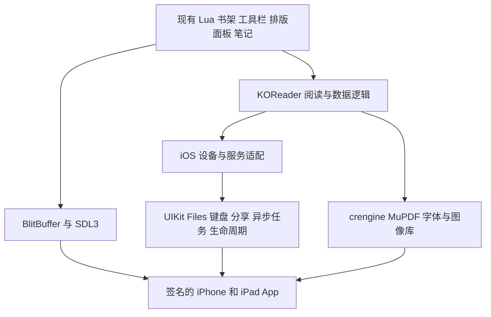

# KOReader 改版在 iPhone 和 iPad 上运行的可行性报告

调研日期：2026-10-23。项目基线：`5e4018b1be8449860120f12c7ee566d529cf3fae`；`koreader-base` 锁定版本：`33b43b5b21a2f2aa7a8b5ad53b6d83d3954f51c0`。

**结论：技术上可行，而且已经有可借鉴的 iOS 移植代码；本项目不需要先重写成 Swift。推荐保留现有 Lua 界面、crengine 和 MuPDF，新增 iOS 平台适配，先交付可在自己 iPhone、iPad 上独立启动的版本，再决定是否投入 App Store 产品化。**

需要纠正一个前提：KOReader 官方没有把 iOS 列为当前支持平台，不代表它在 iOS 上无法运行。公开项目 [hezi/koreader-ios](https://github.com/hezi/koreader-ios) 已提供面向 iPhone、iPad 的 Xcode 侧载实现。它是独立维护的移植分支，不能等同于官方支持或稳定发行版。上游 [iOS 讨论 #5886](https://github.com/koreader/koreader/issues/5886) 也包含维护者对平台适配工作和独立移植的讨论。

本报告依据本分支源码、锁定版本的底层源码、移植分支源码和官方文档。未编译或安装本分支的 iOS App；下文的复用判断、工作量和验收指标是工程评估，不是真机测量结果。

## 1. 三个目标的可行性不同

| 目标 | 判断 | 必须解决的关键问题 |
| --- | --- | --- |
| 在自己的 iPhone、iPad 上安装，阅读本地 EPUB/PDF | 可行性高，适合先做 | 编译、签名、解释器模式、文件导入、触控、进度保存 |
| 保留当前改版的书架、笔记、书源等日常体验，长期稳定使用 | 可行，但需要实质移植 | 后台任务、取消下载、中文输入、生命周期、窗口尺寸、性能 |
| 面向普通用户通过 App Store 分发 | 有条件可行，不能预先保证 | 合规打包、禁用程序热更新、许可兼容性、审核与独立品牌设计 |

iPhone 和 iPad 可以共用一个 Universal App、同一套 Lua 业务逻辑和 C/C++ 引擎。需要分别适配的是可用窗口、输入方式、布局和内存表现，而不是开发两个阅读器。现有移植的 [Info.plist](https://github.com/hezi/koreader-ios/blob/a7cf2a98a28c6e70fb33087549bfb4a734ed19bc/platform/ios/Info.plist.in) 已声明两种设备，但声明支持不能代替两类真机验收。

## 2. 现有移植能帮我们省下什么

本次核查的移植版本为 `hezi/koreader-ios@a7cf2a98`，提交日期 2026-04-27；它依赖另一个底层分支 `hezi/koreader-base-ios@6e4bafc0`。**只复制顶层 `platform/ios` 目录不够，底层构建和 FFI 适配也必须纳入。** 来源：[子模块配置](https://github.com/hezi/koreader-ios/blob/a7cf2a98a28c6e70fb33087549bfb4a734ed19bc/.gitmodules)。

| 已有实现 | 可以复用的内容 | 尚不能据此保证的内容 |
| --- | --- | --- |
| Objective-C 启动器、Xcode 工程生成 | 启动 Lua VM、设置资源和数据目录、签名安装入口 | 当前工具链下干净构建、Release 稳定启动 |
| iOS 交叉编译和 LuaJIT 配置 | 使用 iPhoneOS SDK、ARM64、关闭 JIT | 全部依赖和插件均可运行 |
| SDL3 显示和触摸补丁 | 安全区、旋转、重复触摸过滤、回前台重绘 | iPad 任意窗口尺寸、中文输入完整体验 |
| 原生目录选择器 | Files 授权目录、bookmark 恢复 | 所有云盘的离线、权限变化、写入冲突都已处理 |
| 封面提取分批调度 | 避免一次处理整批图书 | 单本复杂书不会阻塞 UI |

上述内容可在 [启动器](https://github.com/hezi/koreader-ios/blob/a7cf2a98a28c6e70fb33087549bfb4a734ed19bc/platform/ios/ios_loader.m)、[底层构建配置](https://github.com/hezi/koreader-base-ios/blob/6e4bafc0a0619cd69e0961933524581ebed9ef0d/Makefile.defs)、[SDL3 适配](https://github.com/hezi/koreader-base-ios/blob/6e4bafc0a0619cd69e0961933524581ebed9ef0d/ffi/SDL3.lua)、[目录桥接](https://github.com/hezi/koreader-ios/blob/a7cf2a98a28c6e70fb33087549bfb4a734ed19bc/platform/ios/ios_filepicker.m)及[封面管理器](https://github.com/hezi/koreader-ios/blob/a7cf2a98a28c6e70fb33087549bfb4a734ed19bc/plugins/coverbrowser.koplugin/bookinfomanager.lua)中对应核查。

它还存在明确的成熟度限制：

- 作者文档列出无 JIT、PDF 重排 KOPT 不可用、无法 fork、模拟器未验证。普通 PDF 渲染与扫描 PDF 重排是两项不同能力。[构建说明](https://github.com/hezi/koreader-ios/blob/a7cf2a98a28c6e70fb33087549bfb4a734ed19bc/doc/Building_iOS.md)
- [Issue #6](https://github.com/hezi/koreader-ios/issues/6) 报告 Release 调用 `ko_ios_get_safe_area_pixels` 崩溃，怀疑符号被裁剪。这要求检查所有通过 FFI 查找的导出符号，不能仅测试 Debug。
- [未合并的 PR #11](https://github.com/hezi/koreader-ios/pull/11) 修复干净克隆时的 plist 生成、版本号及新 Xcode 构建问题；提交者明确只验证了未签名构建，没有真机启动验证。
- 工程目前限定 `iphoneos/arm64`；plist 设置了 `UIRequiresFullScreen=true`，并关闭多 scene。不能把“可在 iPad 运行”理解为已经做好窗口化和多任务体验。[工程配置](https://github.com/hezi/koreader-ios/blob/a7cf2a98a28c6e70fb33087549bfb4a734ed19bc/platform/ios/project.yml)、[应用配置](https://github.com/hezi/koreader-ios/blob/a7cf2a98a28c6e70fb33087549bfb4a734ed19bc/platform/ios/Info.plist.in)

**采用方式：审查并移植必要补丁到我们自己的分支，同时维护自己的 base 分支。不要整体替换当前项目或把旧版 base 指针直接覆盖上来。** 我们已有更新的上游代码、定制界面和独立翻译子模块，整仓替换会丢失这些工作。

## 3. 对当前项目的具体影响

本项目的生产界面是 Lua widget，自绘到 BlitBuffer；HTML 页面只是设计原型。因此不能把原型装进 WebView 就算完成移植。[产品约束](../PRODUCT.md)

好消息是，新界面已按独立模块组织；这有利于继续复用书架、工具栏、排版和笔记逻辑。[架构决定](adr/0001-new-modules-with-hook-points.md)

| 范围 | 本分支证据 | iOS 必须做的事 |
| --- | --- | --- |
| 平台识别与能力 | [device.lua](../frontend/device.lua)、[SDL device](../frontend/device/sdl/device.lua) | 增加明确 iOS 设备能力，复用 SDL3；避免落入墨水屏模拟器的假 Wi-Fi、假前光和退出菜单 |
| 底层编译与加载 | [.gitmodules](../.gitmodules)、[Makefile](../Makefile)、[setupkoenv.lua](../setupkoenv.lua) | 移植 iOS toolchain、原生模块链接、符号导出和打包 |
| 可写目录 | [datastorage.lua](../datastorage.lua)、[docsettings.lua](../frontend/docsettings.lua) | 分离只读资源、书籍、设置、缓存；外部书籍的笔记不能假定可以写入书旁目录 |
| 书架和封面 | [shelfview.lua](../frontend/apps/shelf/shelfview.lua)、[bookinfomanager.lua](../plugins/coverbrowser.koplugin/bookinfomanager.lua) | 保留分页与缓存逻辑，改造依赖进程的提取调度，验证大书和大书架 |
| 书源 | [booksourceview.lua](../frontend/apps/opds/booksourceview.lua) 的 `fetchThumbs`、`download`、`cancelDownload` | 替换进程式网络任务，保留进度、取消、超时、失败反馈和临时文件清理 |
| 后台重新排版 | [readerrolling.lua](../frontend/apps/reader/modules/readerrolling.lua) 的 `_rerenderInBackground` | 保留正常排版能力，禁用或重写依赖父子进程协作的后台优化 |
| 查词和文件操作 | [readerdictionary.lua](../frontend/apps/reader/modules/readerdictionary.lua)、[filemanager.lua](../frontend/apps/filemanager/filemanager.lua) | `sdcv` 外部进程、`cp/mv` 命令等改成进程内库或原生 API |
| 系统与界面交互 | [readertoolbarpanels.lua](../frontend/apps/reader/modules/readertoolbarpanels.lua)、[readertypesetpanel.lua](../frontend/apps/reader/modules/readertypesetpanel.lua)、[inputtext.lua](../frontend/ui/widget/inputtext.lua) | 亮度、键盘、安全区、字体导入、分享和无障碍按 iOS 能力接入 |
| 设置与退出保存 | [readerui.lua](../frontend/apps/reader/readerui.lua)、[uimanager.lua](../frontend/ui/uimanager.lua) | 把已有保存入口接到 iOS 生命周期，并及时保存关键笔记修改 |
| 扩展与更新 | [pluginloader.lua](../frontend/pluginloader.lua)、[userpatch.lua](../frontend/userpatch.lua) | 随包保留兼容插件；发行版限制外部代码和程序 OTA |

当前 base 已有 SDL3 和 `libkoreader-monolibtic` 加载机制，无须重新发明显示层或统一动态库加载器；需要补的是 iOS 分支和发行方式。[锁定版本的 loadlib.lua](https://github.com/koreader/koreader-base/blob/33b43b5b21a2f2aa7a8b5ad53b6d83d3954f51c0/ffi/loadlib.lua)

## 4. 最重要的工程障碍

### LuaJIT 可以保留，但性能与回调要验证

LuaJIT 官方支持 iOS ARM64 交叉编译；普通 iOS App 应运行解释器模式，关闭 JIT。**关闭 JIT 不等于禁用整个 FFI**，所以 Lua 调用已经编译进 App 的 C/C++ 引擎仍有实现基础。[LuaJIT 安装说明](https://luajit.org/install.html)、[架构开关](https://github.com/LuaJIT/LuaJIT/blob/v2.1/src/lj_arch.h)

另外，LuaJIT 的 `LJ_OS_NOJIT` 配置会禁用 FFI callback。排查时要区分 Lua 调 C、C 经 Lua C API 调 Lua、C 经 FFI callback 调 Lua，不能仅搜索到 `setCallback` 就判定不可用。需要的回调可采用编译好的原生桥或事件轮询。[callback 实现](https://github.com/LuaJIT/LuaJIT/blob/v2.1/src/lj_ccallback.c)

EPUB 排版、PDF 渲染已有 C/C++ 引擎，因此不会所有工作都退回 Lua 解释执行；Lua 密集的界面构建、扫描和数据处理仍需测量。构建时预编译 Lua 字节码只能减少解析开销，不会恢复 JIT 或变成原生 AOT。首轮应测打开大 EPUB、翻页、目录、划线、封面提取和扫描 PDF，而不是仅看启动速度。[LuaJIT 维护者说明](https://github.com/LuaJIT/LuaJIT/issues/1072)

### 无法沿用 fork，不只是把函数换个名字

现成移植的 `runInSubProcess` 在 iOS 上直接执行任务，用临时文件代替管道，最后返回当前进程 ID。这是让部分调用继续工作的兼容办法，不是真正的异步任务。[实现源码](https://github.com/hezi/koreader-base-ios/blob/6e4bafc0a0619cd69e0961933524581ebed9ef0d/ffi/util.lua)

对我们的分支有两个具体风险：

1. “书源”下载在这个函数返回之后才创建进度状态和轮询。若整个下载先同步执行，界面会在下载期间失去响应，取消按钮也不能及时工作。这是由当前调用顺序推导的兼容性问题。
2. EPUB 后台重新排版会等父进程信号，并调用 `getppid()` 和 `os.exit()`。把这段子进程逻辑原样放到主进程执行，可能卡住或退出整个 App；不能用通用的同步降级覆盖它。

建议按实际任务处理：网络下载接原生异步任务或可取消的非阻塞网络实现；封面先复用分批调度，再根据单本耗时决定是否引入独立工作线程；后台重排先走已有前台排版路径。若采用线程，不能让多个线程同时使用同一个 Lua VM 或同一个非线程安全的引擎实例。无需为移植先做一个通用任务框架，但现有进度、取消和错误处理必须保留。

### 文件系统需要重新划清边界

建议首版采用以下结构，继续通过 `DataStorage` 和既有文件入口访问：

| 位置 | 内容 |
| --- | --- |
| App bundle，只读 | Lua 程序、预装插件、内置字体、图标和原生库 |
| Documents | 导入的书籍、用户主动导出的笔记 |
| Library/Application Support | 设置、书籍标识、笔记和数据库 |
| Library/Caches 与临时目录 | 可重建封面、排版缓存、未完成下载 |

首版通过 Files 选择文件后协调读取并复制到书架目录，避免把云盘权限生命周期直接交给阅读引擎。后续若支持“授权整个目录、原地阅读”，需处理 security-scoped URL、bookmark 失效、成对释放权限、云端文件未下载和文件协调；不能只保存绝对路径。[Apple 目录访问文档](https://developer.apple.com/documentation/uikit/providing-access-to-directories)

只读或外部目录的笔记应放到内部 `docsettings`，并处理书籍重新导入、改名后的对应关系。现有 `.sdr` 数据可作为兼容基础，但 Files/iCloud 提供文件访问不等于自动解决跨设备同步冲突。阅读进度同步、书文件同步和笔记同步也应分别验收。

### 生命周期是防止丢笔记的核心工作

不能依赖用户点“退出”才保存。要在关键修改后及时持久化，并在 scene 失活或进入后台时完成必要保存；恢复时重建显示状态，内存警告时释放可重建缓存。后台长时间下载需使用系统允许的机制，不能假设 Lua 循环一直运行。[Apple 运行时约束](https://support.apple.com/guide/security/security-of-runtime-process-sec15bfe098e/web)

SDL 官方特别提醒，生命周期事件可能需要即时处理，操作系统未必给后续事件循环继续运行的机会。已有移植把事件转发到 Lua 并在回前台时重绘，尚不能由此证明保存闭环完整；应复用 `UIManager:flushSettings()`、`ReaderUI:saveSettings()`，通过原生桥确保保存时机，避免仅把工作排到下一次 tick。[SDL3 iOS 文档](https://wiki.libsdl.org/SDL3/README-ios)

Apple 当前文档规定：自 iOS/iPadOS 27 起，使用最新 SDK 构建的 App 必须采用 scene 生命周期，否则无法启动。现有移植 plist 已声明 `SDLUIKitSceneDelegate`，因此应验证其与锁定 SDL 版本的实际衔接，而不是简单重复添加 manifest。单 scene 可以满足首版需求，多窗口同时读不同书是另一项功能。[Apple scene 文档](https://developer.apple.com/documentation/uikit/transitioning-to-the-uikit-scene-based-life-cycle)

## 5. iPhone 和 iPad 的交互适配

保持我们已确定的书架、工具栏、目录抽屉和排版面板结构，但按实际窗口宽度重新布局。不要按“设备是 iPad”就固定采用大屏布局，也不要把像素直接当作 iOS 的 point。

| 两类设备共同必做 | iPhone 重点 | iPad 重点 |
| --- | --- | --- |
| 安全区与坐标统一、中文输入、系统键盘关闭与避让、选择文字和复制、系统分享、深色模式、亮度映射 | 刘海和 Home 指示区、小屏弹层、单手返回、横屏短高度、长书名截断 | 全屏和窄窗口切换、窗口尺寸变化、横竖屏排版、外接键盘与指针、PDF 缩放与内存 |

当前墨水屏控件名称并不意味着不能在 LCD/OLED 使用，但全刷、残影、前光色温等功能不应作为 iOS 设置展示。先保证即时反馈、触控和布局正确，再考虑与产品目标一致的动画；移植本身不会自动获得微信读书手机版的流畅动效。

SDL 自绘内容也不会自动获得 UIKit 控件的 VoiceOver 信息。应为书架项、工具栏、目录和正文选择等关键内容建立可访问元素、标签、顺序和操作，并测试大字体与 VoiceOver。原生输入框、文件选择器和分享面板可减少这部分工作。[Apple VoiceOver 文档](https://developer.apple.com/documentation/uikit/supporting-voiceover-in-your-app)

首个技术原型可先验证单窗口全屏阅读；稳定的 iPad 版本需要把尺寸变化纳入验收。Apple Pencil 手写、多窗口同时打开多本书不属于“让现有 KOReader 在 iPad 可用”的前置条件，可单独评估。

## 6. 分发和上架的额外条件

| 分发方式 | 适用阶段 | 已核实的限制 |
| --- | --- | --- |
| Xcode 免费 Personal Team | 自有设备 PoC | provisioning profile 7 天到期，需要重新签名部署 |
| 付费开发者账号下的开发或 Ad Hoc 安装 | 较长期的受控真机测试 | 仍受设备登记和签名管理约束，不是公开商店分发 |
| TestFlight | 更广范围的测试 | 每个构建最多测试 90 天；外部测试可能需要审核 |
| App Store | 面向普通用户 | 需通过包验证和审核，并解决许可、隐私与产品设计问题 |

来源：[Apple 账号说明](https://developer.apple.com/help/account/basics/about-your-developer-account)、[Ad Hoc 分发](https://developer.apple.com/help/account/provisioning-profiles/create-an-ad-hoc-provisioning-profile)、[TestFlight 概览](https://developer.apple.com/help/app-store-connect/test-a-beta-version/testflight-overview/)。

**打包。** 现成移植把独立 `.dylib` 放在 `app/libs`，不能直接当作上架方案。Apple 文档明确 iOS 不支持 framework 外的第三方独立动态库，Xcode 提供的 Swift 系统库例外。发行时应使用规范 framework 或静态链接；选择静态链接时，还要保留 FFI 符号并注册 Lua C 模块。应尽早验证 Archive，避免最后才发现链接和签名方案要重做。[Apple Bundle 规则](https://developer.apple.com/documentation/bundleresources/placing-content-in-a-bundle)

**程序更新。** App Review 2.5.2 对下载、安装或执行改变功能的代码有限制。建议上架版随签名包交付 Lua 和兼容插件，关闭程序 OTA、外部 Lua 插件安装及 userpatch 入口；书籍、字体、字典等数据导入另行保留。这不等于禁止所有解释型语言，也不意味着所有插件都必须删除。[Apple 审核指南](https://developer.apple.com/app-store/review/guidelines/#software-requirements)

**微信读书设计。** 目前“完全照抄”的目标，在个人实验和公开上架中面临不同约束。Apple 4.1 明确反对照搬其他 App 的界面、名称或品牌。若公开发行，应保留易用的交互原则，并采用自己的视觉表达、图标、文案和品牌；本报告不改变当前设计要求，但这项发行风险需要纳入路线选择。[Apple Copycats 规则](https://developer.apple.com/app-store/review/guidelines/#copycats)

**开源许可。** 本项目使用 AGPLv3，分发修改版需履行相应源码、版权和许可证等义务，并核对各依赖。App Store 使用条款与 copyleft 权利限制之间存在必须认真核查的兼容性问题；不能认为公开代码就一定足够，也不能仅用历史案例断言所有 AGPL App 都绝对无法上架。若把 App Store 作为硬性目标，应在大规模开发前核查实际协议和权利链。仅购买 MuPDF 商业许可不会解除整个 KOReader 的许可义务。[项目许可](../COPYING)、[FSF 对相关冲突的原始分析](https://www.fsf.org/blogs/licensing/more-about-the-app-store-gpl-enforcement)、[Apple 标准 EULA](https://www.apple.com/legal/internet-services/itunes/dev/stdeula/)

隐私声明、实际使用 API 所需的隐私清单、网络凭据存储和依赖声明，应按最终发行包核对。没有使用的权限不申请；无须为了移植额外增加账号或云服务。

## 7. 推荐架构与实施顺序

| 路线 | 取舍 | 建议 |
| --- | --- | --- |
| 现有 Lua 界面加 iOS 适配 | 最大限度保留当前改版、阅读行为和上游兼容性；需补原生集成 | 首选 |
| 全部界面重写为 SwiftUI/UIKit，保留引擎 | 原生交互空间更大，但需要重新连接阅读状态、笔记、目录、排版和设置 | 只有长期决定主要做 iOS 产品时再评估 |
| 把网页原型或 Android 包装进容器 | 网页不是当前生产实现；也不能借此绕过沙盒和本地依赖移植 | 不作为本项目移植路线 |

**阶段 A：用现成移植验证最大的未知数，预计 1–2 人周。**

在独立工作目录固定 hezi 顶层和 base 版本，审查构建修复，建立可复现构建；首先在 iPhone、iPad 上验证 Release 独立启动、中文 EPUB、普通 PDF、触控、输入、进度和笔记保存。同时建立最小 framework/静态链接打包试验；如确定要上架，并行完成许可路线核查。

出口：得到两台设备的可复现结果、性能记录和剩余阻塞项。若符号、解释器性能或数据保存仍不可靠，先解决这些问题，不进入全量界面合并。

**阶段 B：接入当前改版，新增 3–5 人周。**

把必要平台补丁接到当前顶层和 base；保留自定义翻译及已有改版模块。完成设备能力、沙盒路径、Files 导入、关键保存事件、中文键盘、安全区和书架封面适配；提供 EPUB/PDF 阅读、目录、排版、划线、想法、书签和恢复阅读。个人版累计约 4–7 人周，前提是阶段 A 未发现大的引擎障碍。

**阶段 C：达到日常稳定使用，新增 4–8 人周。**

完成书源异步下载和取消、查词替代、分享导出、iPad 尺寸变化、无障碍、长书性能、内存及错误恢复。建立模拟器构建与自动回归；在 Android/Kindle 路径验证共享改动没有回归。累计约 8–15 人周。

**阶段 D：公开发行准备，新增 4–8 人周以上。**

完成发行打包、签名流水线、代码更新入口约束、隐私与许可材料、独立品牌视觉及 TestFlight 验证。累计约 12–23 人周以上；审核等待、许可协商和新增产品设计不包含在工程工时里。

这些是基于代码范围的粗估，假设一名熟悉 C/C++、Lua 和 iOS 的工程师全职投入，拥有一台 iPhone 和一台 iPad，不新增 DRM、云账号体系、社交或商店。初步预算可按“个人版约 1–2 个月，稳定版约 2–4 个月，公开发行约 3–6 个月以上”理解；两名工程师不会简单把时间减半。阶段 A 结束后应重新估算。

## 8. 必须通过的验收

以下是建议验收标准，不是本次已完成的测试。

| 方面 | 验收内容 |
| --- | --- |
| 构建与启动 | 从干净检出构建；iPhone/iPad 的 Release 关闭调试器后可启动；检查所有 FFI 导出符号；Archive 验证 |
| 阅读 | 中文长 EPUB、英文 EPUB、文字 PDF、扫描 PDF各有样本；目录、改字体、划线、想法、书签、再次打开位置正确 |
| 数据可靠性 | 完成笔记后切后台、锁屏、正常恢复、后台进程被回收和升级安装；验证已保存的数据不丢失、缓存可重建 |
| 文件 | Files 导入、重名、只读来源、云文件未下载、权限失效、空间不足；失败后无损坏书籍、无误覆盖 |
| 书源 | 慢网络、断网、超时、取消、重试、多本下载；UI 能响应、进度可信、临时文件被清理 |
| 输入与无障碍 | 中文拼音组合、候选词、选中删除、粘贴、键盘收起；VoiceOver 可操作关键阅读流程 |
| 尺寸与性能 | 小屏 iPhone、iPad 全屏和窄窗口、旋转、外接键盘；测冷启动和翻页耗时、主线程停顿、峰值内存及持续阅读耗电 |
| 回归 | 共享改动不破坏 Android/Kindle 的设备能力、书架、书源、保存和已有测试 |

建议最初记录至少 30 次翻页的中位数与较慢样本、长书打开时间和 30 分钟阅读的内存/耗电变化，先建立基线再设优化目标。不要用模拟器速度替代真机，也不要把社区作者的启动耗时当成本项目指标。

## 9. 当前建议

**值得启动一个有明确退出条件的 1–2 周技术验证。** 现有独立移植已降低“是否可能”的不确定性，当前项目也具备可复用的界面和 SDL3 基础。真正需要投入的是把桌面/墨水屏平台假设替换为 iOS 的文件、任务和生命周期模型。

第一版建议以本地 EPUB/PDF 和当前核心阅读交互为范围。完整书源交互、查词和稳定 iPad 窗口体验在后续阶段补齐；扫描 PDF 重排、终端、SSH、程序热更新和任意外部代码插件分别评估，不能承诺与原平台无差别。没有必要为了第一版先重写界面、升级整个产品架构或建立云服务。

本机已能定位完整 Xcode 和 iPhoneOS SDK；但当前仓库的 base、字体、测试数据等子模块未初始化。本次通过锁定提交的远程源码完成底层审阅，没有下载完整依赖或执行构建。报告只新增文档，没有改动生产代码。

未验证项：iPhone/iPad 真机、完整编译、签名 Archive、实际性能和完整许可审计。主要风险：现成移植仍有构建及运行缺口，工作量需在技术验证后收敛；App Store 通过与许可兼容性不能预先保证。
