# B4：dp、安全区和窄屏交付记录

对应 #92；依据 decisions Q5/Q6/Q7/Q25/Q39/Q46、ADR-0008、B0 的
[窄屏清单](narrow-screen-survey.md)，以及 T0 的 point/pixel 表。

## 实现与原生接入

- iOS 屏幕实例按完整 framebuffer / SDL window 的宽度取得 pixel/point，
  `scaleBySize`、`scaleByDPI` 均为 `ceil(dp × scale)`；`display_dpi = 160 × scale`
  是 dp 标尺，不是真实 PPI。T0：iPhone 3px/pt、iPad 2px/pt；44dp 分别为
  132px、88px，即 44pt。旧的 `screen_dpi` 设置不改变 iOS 控件大小。
- `iosnative/safearea.lua` 使用
  [SDL_GetWindowSafeArea](https://wiki.libsdl.org/SDL3/SDL_GetWindowSafeArea)，
  不增加 Swift 或 `ko_ios_*` 桥。桥返回 SDL window 坐标的四边 inset；设备层
  向内取整到像素 viewport。可用内容为安全区，完整 buffer 留作整屏底色。
- 只注册一次触摸平移，后续修改同一 offset 表；尺寸、像素尺寸、安全区事件
  复用 SetDimensions → ScreenResize → RedrawCurrentPage，再重建 FileManager
  的原有通知路径。正文位置沿用 ReaderRolling 的内部历史，不存第二份位置。
- R1：390dp 为两列 123dp 封面；书架 123×178、gap 22、gutter 61；
  书源 123×164、gap 20、gutter 62。低于 457dp 时关闭书源的缩小封面换行数逻辑。
- R2：按每条轨道实际档距判断，小于 33dp 时向点按方向走一档；绘制尺寸不变。
- iOS 的最小触控尺寸能力值为 44dp，扩展 PillButton、ShelfWidgets.Tappable
  的命中区域，搜索框、文字动作、chip 也受益；默认设备值为 0，保持墨水屏命中区域。
- PRODUCT 的 Users、Operating Context、Capabilities、Accessibility，以及
  DESIGN 的两档布局、内容彩色、LCD refresh 注记已更新。未修改 design/demo。

## iPad 观察项裁定

| B0 项 | 本票处理 | 理由 |
| --- | --- | --- |
| P1 封面放大 | 保留原有按英寸阈值算列数 | 单凭宽度大于 600dp 加上限会改变墨水屏横屏；advisor 要求零回归，本票不另加规则。iOS 的列数仍取决于点标尺及实际宽度。 |
| P2 字体网格变宽 | 保留 2–5 列 | 属于既有大屏比例布局，没有溢出，不引入第三套平板布局。 |
| P3 列表行变长 | 保留全宽行 | 沿用目录页和我页的比例布局；没有遮挡或放不下。 |
| P4 工具栏图标较散 | 保留均分 | 保留相同导航与可点击单元，不因 iPad 引入另一套工具栏。 |
| P5 居中卡片留白 | 保留 458dp / 416dp 上限 | 原有设计意图，避免卡片和笔记行长随屏幕无限增长。 |
| P6 默认边距未限 38 字 | 留给 owner 后续决定 | 墨水屏横屏也有相同行为；本票不改变默认书籍排版。已选边距的既有上限保持。 |

## 离屏渲染证据

基线为本分支起点 `4f3ff7d1d`。从 git archive 得到基线 Lua，当前分支为另一套
Lua 源；两者使用同一份现有 macOS Emulator 库、字体和已编译语言目录。运行目录、
设置、缓存、样书副本均在 `/tmp/jr-92-render`，owner 主检出只读。

运行 [render-b4.lua](../../tools/ios/render-b4.lua)，没有加载 commonrequire 或任何
spec。每个尺寸单独进程；每次重建相同绝对路径的 KO_HOME，固定显示时间，避免路径、
时钟或旧元数据造成无关差异。书源用确定性假 feed，使用真实入口和页面构建；阅读
使用随测试数据提供的 juliet.epub 副本。现有编译语言目录包含中英混合文案，图片只
证明这些输入的布局，真实 iOS 包的竖屏冒烟另见下文；最大界面字号仍留给 owner 复核。

每组 11 页：书架、导入、阅读、工具栏、排版、进度、目录、笔记、书源、书源空状态、我。
原始截图和日志保留在 `/tmp/jr-92-render/captures/{before,after}/<尺寸>/`；
[comparison.json](b4-layout/comparison.json) 记录每张 PNG 前后 SHA-256。
PNG 文件字节一致比逐像素一致更严格；没有把截图比较称为已运行 spec。

| 尺寸 / 标尺 | PNG 完全一致 | 预期差异 |
| --- | --- | --- |
| 600×800，Emulator，142dpi，短边 600dp | 11 / 11 | 无 |
| 1264×1680，Emulator，300dpi，短边 600dp | 11 / 11 | 无 |
| 1680×1264，Emulator，300dpi，短边 600dp | 11 / 11 | 无，覆盖墨水屏横屏 |
| 390×844，B0 的 1dp=1px 标尺 | 9 / 11 | 书架、书源落实 R1；R2 不改变绘制 |
| 820×1180，B0 的 1dp=1px 标尺 | 11 / 11 | 无，P1–P6 均保持原有布局/行为 |

代表截图：

| Emulator 600dp | Emulator Leaf5 等效竖屏 | Emulator Leaf5 等效横屏 |
| --- | --- | --- |
|  | 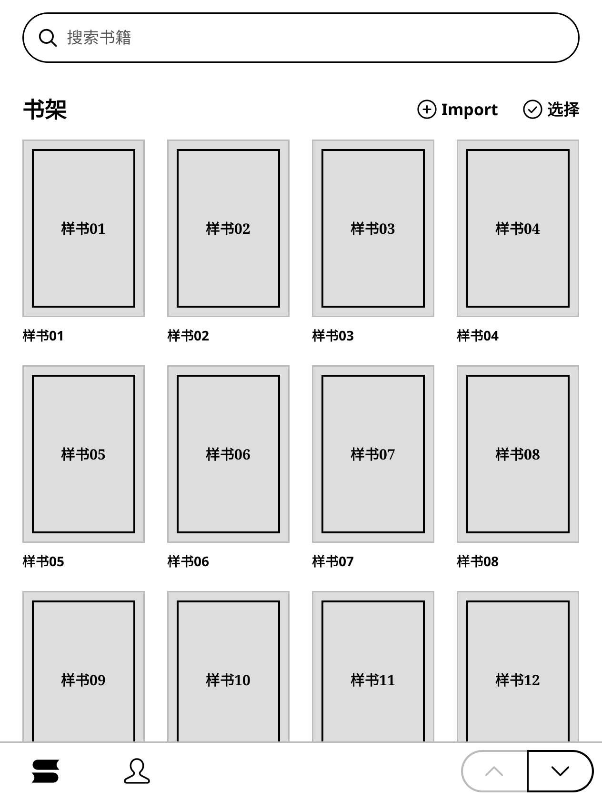 | 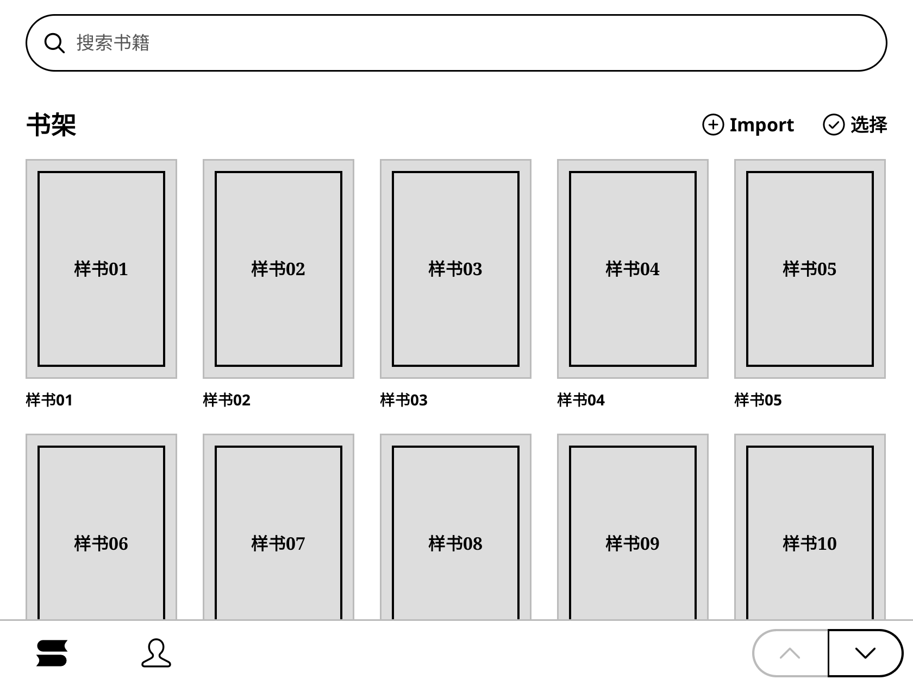 |

| 390 书架 | 390 书源 | 390 排版 | 820 书架 |
| --- | --- | --- | --- |
| 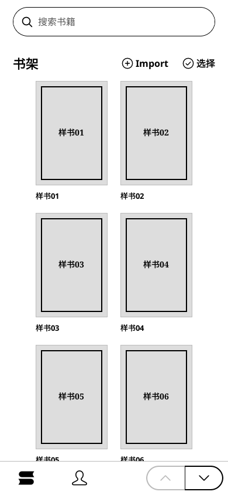 | 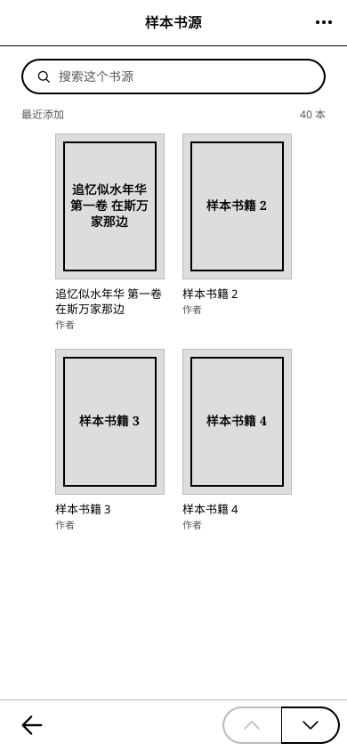 | 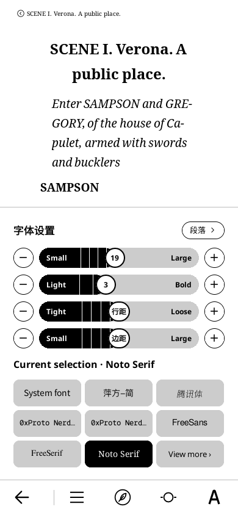 | 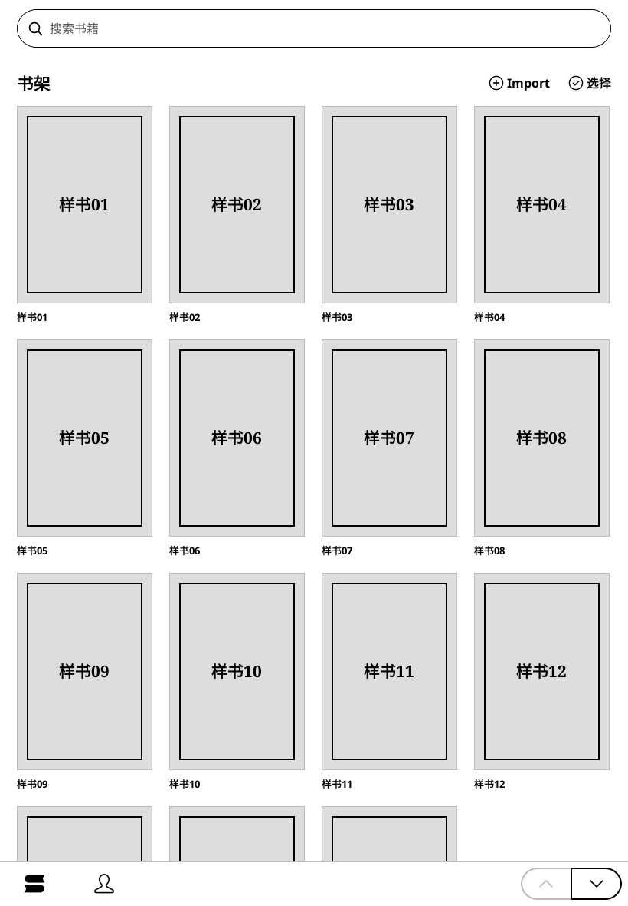 |

## 原生构建与竖屏冒烟

2026-10-25，B1 合并后 rebase 到 `origin/master`（包含 #147），初始化 base 与构建所需
子模块。base 的后续改动在独立分支 `feat/92-ios-safe-area`：安全区事件转发、完整
allocation 释放、夜间边缘 texture 更新，以及仅 iOS 生效的首帧 window point 查询。
像素尺寸事件原来已转发。补丁说明见 [base-fork.md](base-fork.md)。主仓库增加
`SDL_GetWindowSafeArea` 符号保留、隐藏状态栏与手机横屏的 plist 键，没有写 Swift 桥。

首次完整构建及两次增量构建均成功；后续构建只在锁内执行：

```sh
export CCACHE_BASEDIR=/Volumes/T5/github/koreader-wt
lockf -t 7200 /tmp/justreader-ios-build.lock ./kodev build ios
# 构建结束后释放锁，直接使用 simctl；不在锁内挂 console。
xcrun simctl install <UDID> <Release-iphonesimulator/JustReader.app>
xcrun simctl launch --terminate-running-process <UDID> me.justinyan.justreader
xcrun simctl io <UDID> screenshot <output.png>
```

构建为 Xcode 27.1、arm64 `iphonesimulator` Release；门禁通过：472 个符号、无松散
动态库。最后一包顶层为 `5eaed614c60c768cf06e64656e24a351ce01fb0e`，base 为
`24c2188653aa4efe299498667ffa7c3b0c8b5dba`；随后 base rebase 到 fork master 的
`0ae4ce65ac815ce7079cbbcf155ad9aae0287c96`，前后 tree 相同。实际包的 plist
核对了 `UIStatusBarHidden=true`、`UIViewControllerBasedStatusBarAppearance=false`、
`UIRequiresFullScreen=true`、手机三个方向及原有 iPad 四个方向。

独立创建的两台 `92-` 模拟器均为 iOS 27.0 `24A434`；宿主为 Apple M4 Pro、64GB、
macOS 26.6.2 `25G83`。模拟器被统一关机后用 CLI 重新 boot；没有操作 Simulator.app。

| 项目 | 92-iPhone 17 Pro Max | 92-iPad Pro 11 M5 |
| --- | --- | --- |
| UDID | `066C38A4-155F-4CB0-9F15-6E05C6486FA6` | `0C4CD5EF-998F-4205-8846-8D6D0432BEF5` |
| window / framebuffer | 440×956pt / 1320×2868px | 834×1210pt / 1668×2420px |
| scale / 44dp / synthetic DPI | 3 / 132px / 480 | 2 / 88px / 320 |
| 安全区 inset（上右下左） | 62 / 0 / 34 / 0pt | 0 / 0 / 20 / 0pt |
| 内容 viewport | (0,186) 1320×2580px | (0,0) 1668×2380px |
| R2 字号轨道 | 档距约 23.70pt，点第 10 档从第 5 档只走到第 6 档 | 档距约 67.44pt，同样点按从第 5 档直接到第 10 档 |

用沙盒外临时驱动轮询命令文件，经真实页面入口/事件进入各页并读取屏幕几何；驱动
只存在于这两台模拟器的用户 patches，不打进包，不加载 spec 或断言。书架使用 14 本
自建中文 TXT、公开 juliet EPUB 及自建 RGB PDF；书源传输 seam 使用确定性假 feed，
仍调用真实页面构建。第一次启动现有的“未安装思源宋体”提示关闭后继续，中文 chrome
使用包内思源黑体；系统中文正文字体的注册/选择属于后续字体集成验收。

两台逐页查看书架、导入、阅读、工具栏、排版、进度、目录、笔记、书源、书源空状态和我：
默认界面字号下无控件越出安全区或意外截断。字体名长于 chip 时保留原有省略号。
iPhone 书架/书源均为两列 123dp；iPad 保留原有按英寸阈值的五列及面板比例，没有
引入第三种布局。44pt 的命中范围由设备能力值与对应 spec 覆盖；CLI 驱动的页面事件
不替代真人触摸体验验收。

彩色 EPUB 封面、RGB PDF 都保留颜色；无封面的书源页面全部像素为灰度。夜间模式
打开后，两台屏幕上下边缘采样均为 RGB(0,0,0)，关闭为 RGB(255,255,255)，没有
安全区外白边；PDF 色块也随整屏反色。`simctl ui <UDID> appearance dark` 后 App
仍为日间、inverse=0。覆盖安装最后一包后再次打开 PDF、切换夜间和系统深色外观，
同样通过冒烟。

[原始几何、R2 状态、样书 SHA、PNG SHA 与像素采样](b4-layout/native/manifest.json)。
以下截图均来自 `simctl io screenshot`；同目录另存两台的其余逐页 PNG。

| iPhone 书架 | iPhone 排版 | iPhone 书源 | iPad 书架 |
| --- | --- | --- | --- |
| 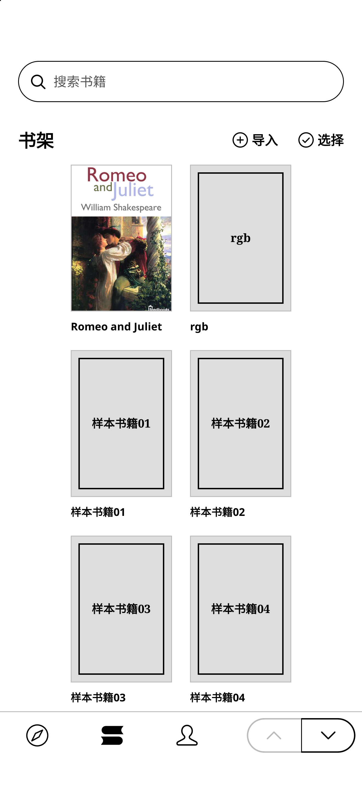 | 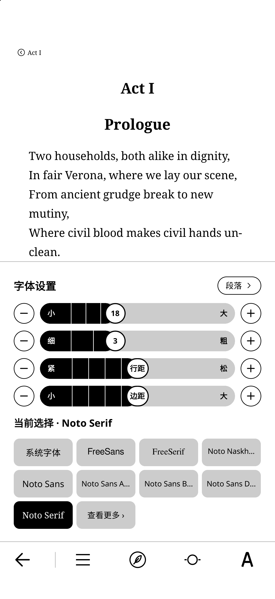 | 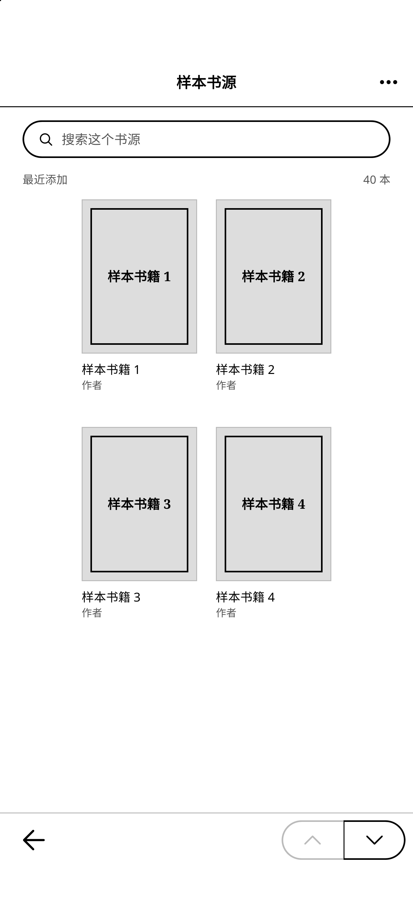 | 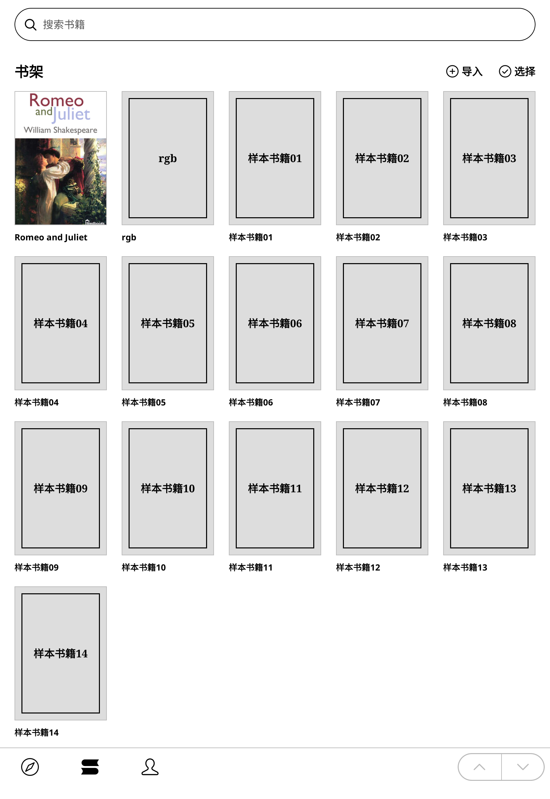 |

| iPhone PDF | iPhone 夜间 | iPad 排版 | iPad PDF |
| --- | --- | --- | --- |
| 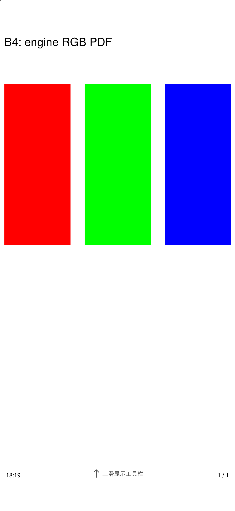 | 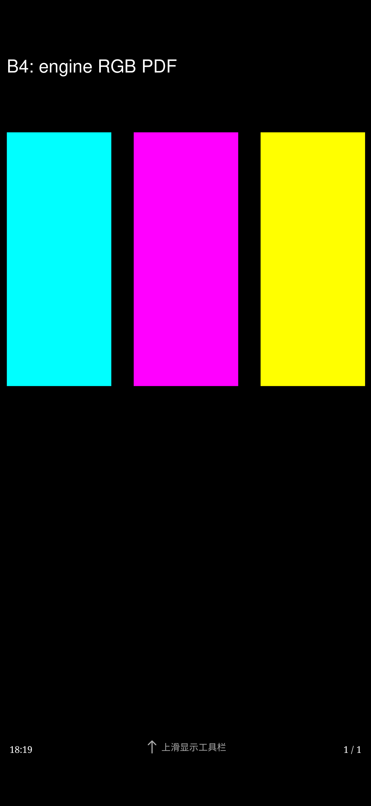 | 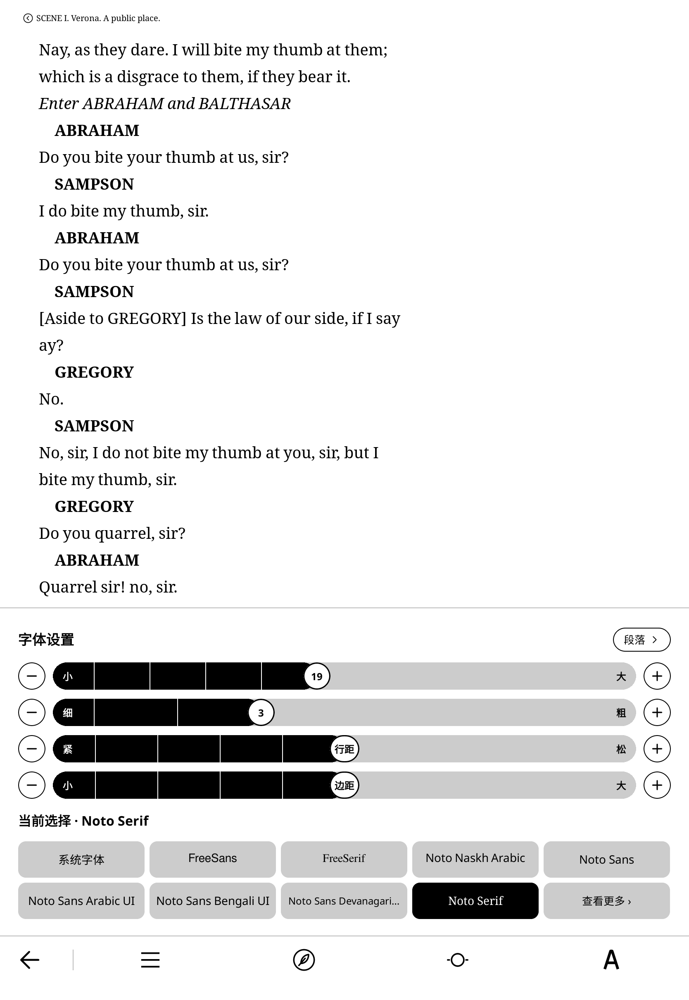 | 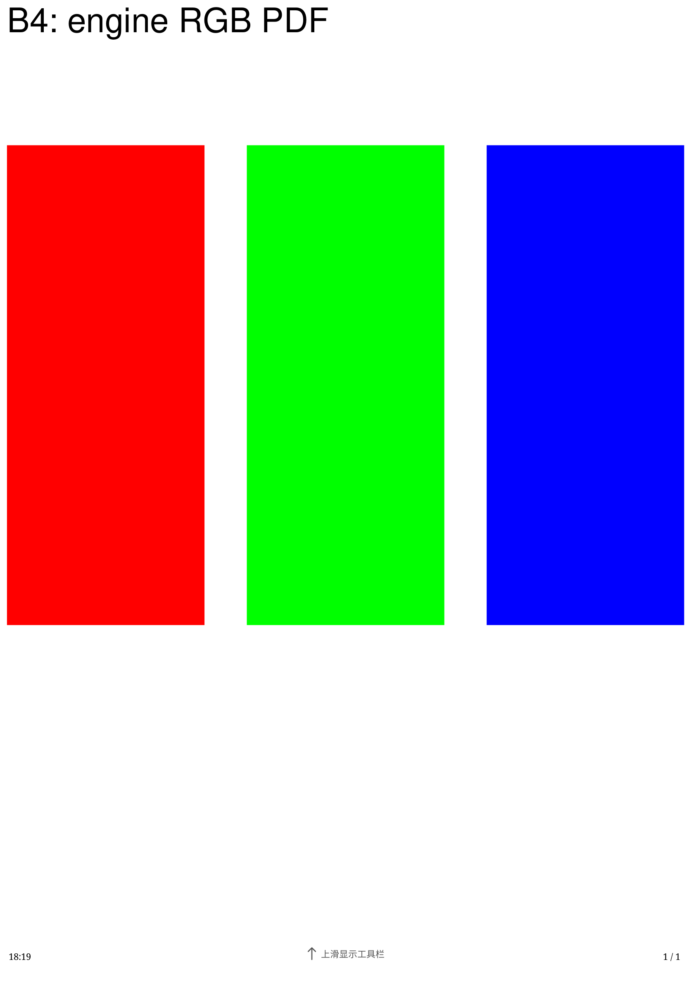 |

## Spec、审查与未验收项

**测试已编写、按 Q46 未运行**，也没有做 Leaf5 实机验收：

- `ioslayout_spec.lua`：接缝 C，真实设备初始化及输入分发配假桥/假窗口；覆盖倍率、
  保存的非零软件旋转、旧事件尺寸、resize 和仅安全区变化、触摸偏移及完整底色。
- `narrowscreen_spec.lua`：接缝 B，390/820 的书架/书源几何、R2 分支及 iOS 命中区域。
- `readertypesetpanel_spec.lua`：接缝 A，横竖屏及 inset 高度变化后同一正文位置。
- base 的 `SDL3_spec.lua`、`framebuffer_SDL3_spec.lua`：首帧点/像素、旧窗口设置、
  桌面原行为、viewport allocation 释放、软件旋转、夜间边缘及 flash shadow。

Lua 文件仅做 loadfile 语法解析，diff 做空白检查。按 implement 技能做了 Standards /
Spec 两路只读 code-review；发现的软件旋转物理轴及 flash shadow 问题已修复并补
spec，复核通过。末次复核也确认旧事件尺寸不会再混入当前 renderer 像素。

物理横竖屏切换后回到同一段正文、仅原生安全区变化、真实触控手感、最大界面字号和
系统键盘遮挡仍**未验收**。owner 指示禁止 builder 操作 Simulator.app，GUI 项移交
[acceptance.md 的真机复核](acceptance.md#两台设备分别复核)。对应逻辑已有 spec，
不将“写了 spec”记作运行通过。P1/P6 的后续决定见上表。

### 第 1 轮审查修正

- 修正三处 spec：夜间页边检查 `getPixelP` 的原始字节；SDL texture mock 读取
  `SDL_Rect.w/h`；首帧 SDL mock 补齐无条件调用的 `SDL_EnableScreenSaver`。
  allocation 用例确认旧完整 buffer 从拥有内存变为已释放，不再断言从未拥有内存的 view。
- iOS 在重建前比较当前 window point、renderer pixel 和计算后的 viewport；三者均未
  变化时跳过 buffer/texture 重建、三次广播和 FileManager reinit。补写启动的重复事件、
  一次旋转的三个事件、仅像素变化、点标尺变化而像素几何不变的 spec。
- 通用 SDL resize 重新应用已配置的 `EMULATE_READER_VIEWPORT`，保留软件旋转和
  原有触摸平移；补写窗口缩放和非零软件旋转的覆盖。未改无 viewport 的桌面行为。
- PRODUCT 的命中范围说明收窄到 Tappable、PillButton；没有声称 Toggle、TickTrack、
  Segmented 也获得了扩展。
- 去重后的原生启动截图发现底栏已在 BB 中、却未上传到 texture。按 advisor 的方案 C，
  在 SDL framebuffer 的 iOS viewport 路径为新 buffer/texture 保留一次完整内容上传，
  之后恢复局部上传；建立 viewport 的清白帧不提前消费标记。没有改共享书架的刷新
  声明。补写首个内容帧、resize 后首帧和 Emulator 局部上传不变的 spec。
- spec 的 `setup` 显式预加载真实 UIManager，避免单独筛选用例时 FileManager 的首次
  加载覆盖假 UIManager；两路只读审查及该隔离修正的复核均未运行测试。

本轮 spec 同样按 Q46 只编写、不运行；原有 PNG/SHA 记录仍对应前述构建，不作为
本轮新增 spec 已通过的证据。
