# 窄屏离屏采集（B0）

issue #87 的交付物。在 390×844 和 820×1180 两个尺寸、1dp = 1px 下离屏渲染十个页面，逐张标出溢出、截断和触控目标不足 44dp 的组件，再为放不下的组件整理"窄屏"规则清单，供 B4 落地。依据：decisions.md Q7、Q29，ADR-0008，CONTEXT.md 的"窄屏"词条。

结论先说：十个页面在 390 宽都能渲染，没有报错。大部分组件按现有比例规则自然收敛。需要补规则的只有两处：封面网格的列数（书架和书源共用），以及排版面板四条轨道的档位间距。820 宽没有放不下的组件，但有几处被拉稀、拉长，列为 iPad 观察项，交给 B4 判断。

## 怎么采集的

- **环境**：本机没有 issue 里说的 Docker 测试脚本，改用原生模拟器构建（`koreader-emulator-arm64-apple-darwin25.6.0-debug`）离屏渲染。一次性的 luajit 脚本按 `spec/unit/commonrequire.lua` 的方式初始化（`einkfb.dummy`，不开 SDL 窗口），各页面从真实入口打开：点书架标题行的导入、点屏幕中间呼出工具栏、点工具栏图标、`ShowConfigMenu`、`ShowToc`、点底部标签。替换模块按 `reader.lua` 的方式注册。脚本按 issue 规定不提交。
- **尺寸和 dp**：dummy framebuffer 改为 W×H，`scaleBySize` 和 `scaleByDPI` 在加载 `ui/size` 和字体之前打成恒等，所以 1dp = 1px。`getDPI()` 保持默认的 160，下文"DPI 依赖"一节会说明它对列数的影响。
- **界面语言**：zh_CN，用的是 master 锁定的 l10n 提交 `940ddc4`。
- **数据**：14 本中文书名的书，书名长短不一，含两个英文书名；书架上的封面是没有缓存时的文字封面。阅读页类页面用 `juliet.epub` 的第 10 页，笔记页先划两条线。进度面板灌了偏长的数值（阅读 123.4 小时、约 327 小时后读完、1234 条笔记）来压测三列。书源接一个本地 stub 的 Calibre-Web 风格 feed，有 40 本书和缩略图，另附一张没有书源时的空状态截图，不计入那十张。
- **标注**：脚本记录最后一次全屏重绘里每个 widget 的位置和大小，自动初筛三类问题：越出屏幕的、`TextWidget` 被截断的、可点组件宽或高不足 44dp 的。初筛结果逐条人工核对过，误报已从截图里删掉（见文末"已排除的误报"）。另外手工加了两类框：规则项和 iPad 观察项。
- **对照**：同一脚本另渲染了 600×800、约 142dpi 的 Leaf5 等效尺寸作为对照，只用来区分"窄屏才有"和"墨水屏上本来就有"，这些图不提交。

图例：🟥 溢出 · 🟧 截断 · 🟦 触控目标 < 44dp · 🟪 R*n* 规则项 · 🟩 P*n* iPad 观察项。截图里的数字和下文条目一一对应。

## 390 × 844

| 页面 | 截图 | 标注 |
|---|---|---|
| 书架 | 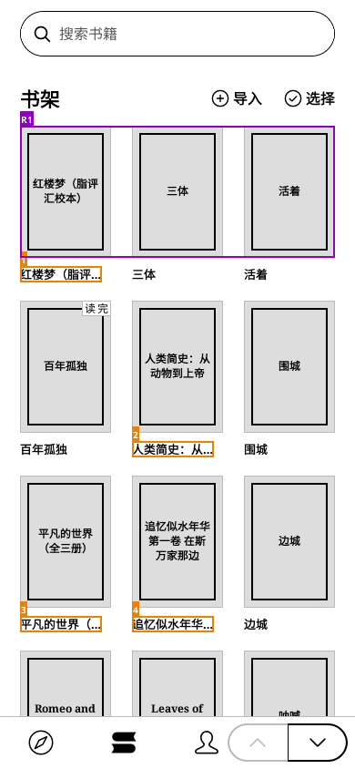 | **R1** 封面网格：3 列，封面 100×145dp，是 Leaf5 参考（123×178，对照图实测 122×177）的 0.81 倍。 **1–4** 书名单行截断：这是设计（一行粗体书名，末尾省略号），但标题宽度跟着封面降到 100dp。对照图同一批书名在 122dp 下也截了 4 本，截断数量没有变多。 第 4 行封面伸进底栏是设计里的 peek（下一页第一行露出一截），不是溢出。 搜索框 346dp 宽，标题行"书架 / 导入 / 选择"放得下：**自然收敛**。 |
| 导入页 | 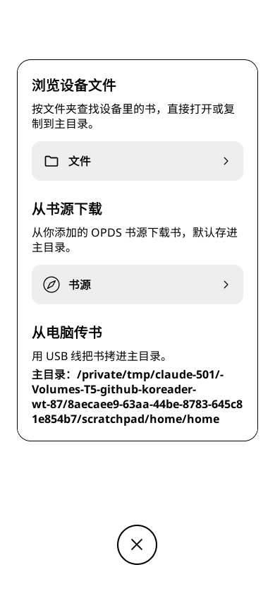 | **自然收敛**。卡片按"最宽 458dp"收到约 342dp，说明文字和两行入口都放得下。主目录路径很长时（截图里是采集用的临时目录，iOS 沙盒路径同样很长）会折成多行，卡片随之变高，没有截断。 |
| 阅读页 | 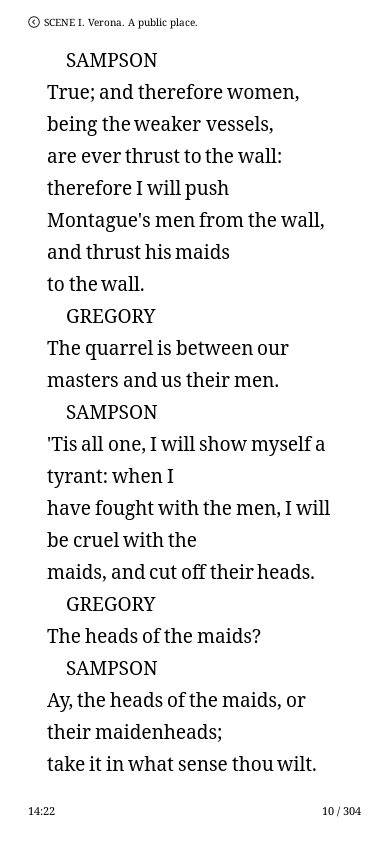 | **自然收敛**。边距 28dp，19dp 字号下一行约 17.6 个汉字（600 宽约 28.6 个）。页眉、页脚和正文边对齐。 |
| 工具栏 | 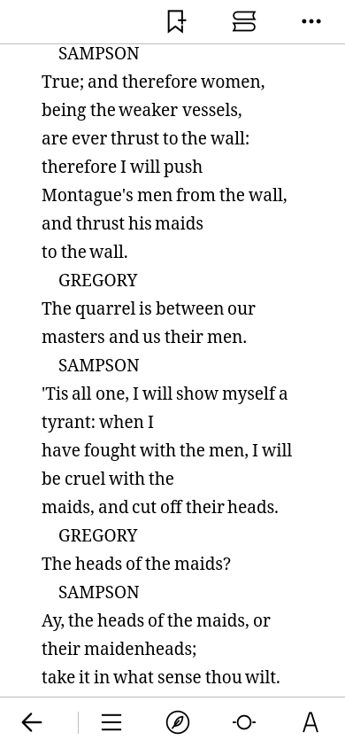 | **自然收敛**。顶栏三个图标、底栏五个图标都放得下，间距约 80dp。 |
| 排版面板 | 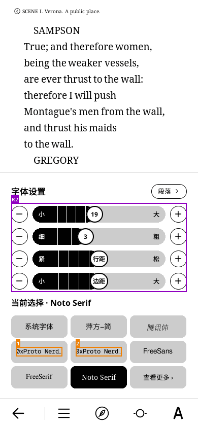 | **R2** 四条轨道的档位间距：字号 18dp、字重 27dp、行距 20dp、边距 20dp（600 宽分别是 42、62、46、46dp），都小于 33dp 的旋钮。点轨道"跳到最近一档"已经点不准。− / + 圆钮的触控区不受影响。 **1–2** 字体卡片里的长字体名截断：600 宽同样截断，不是窄屏引入的。 字体网格：按 `floor((w + gap) / 100dp)` 算列数，390 宽 3 列、卡片约 105dp，和 600 宽的 5 列 106dp 同尺寸，只是少显示几款字体：**自然收敛**，不需要规则。 |
| 进度面板 | 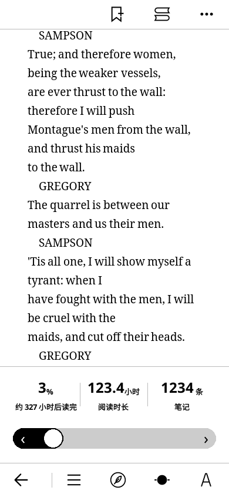 | **自然收敛**。三列每列 114dp。压测数值（123.4 小时、约 327 小时后读完、1234 条）都放得下，最长的是估算行，约 105dp。按当前字号推算，宽度低于约 361dp 才会开始截断，比现有最窄的 iPhone（375pt）还窄。 |
| 目录页 | 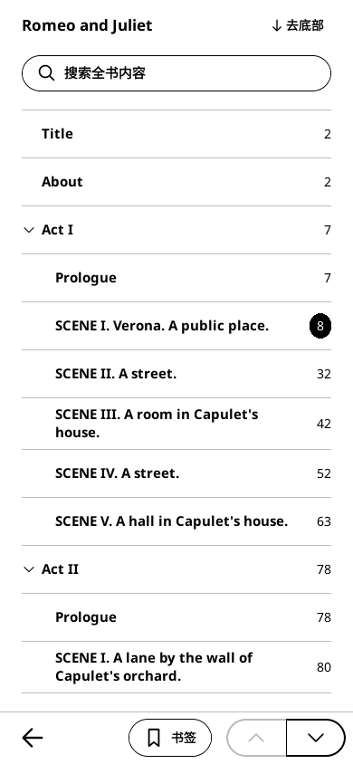 | **自然收敛**。长章节名折成两行，页码右对齐。搜索框 342dp。底栏的返回、书签、翻页都放得下。 |
| 笔记页 | 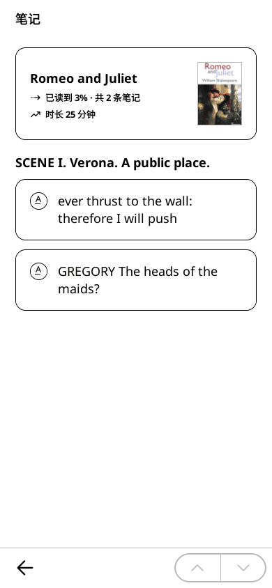 | **自然收敛**。约 416dp 的卡片列收到 346dp，概览卡和笔记卡都放得下。 |
| 书源 | 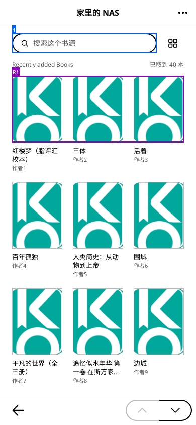 | **R1** 封面网格：3 列，封面 100×133dp。Leaf5 上是 4 列 123×164dp，降幅和书架相同。 **1** 书源搜索框只有 40dp 高，可点区域也是 40dp：`buildSearch` 用 `Tappable` 包住 40dp 的框，没有走同文件的 `tallTarget`。这和宽度无关，600、820 宽也一样，归入下文"既有的触控目标不足"。 搜索框宽 288dp 加分类按钮 44dp，放得下：**自然收敛**。 |
| 我 | 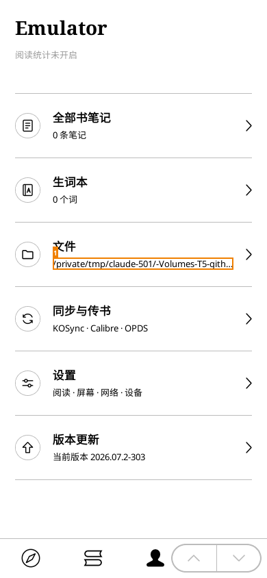 | **1** "文件"行的主目录路径单行截断：这是设计（行内副标题省略），600 宽同样会截。 其余六行、圆形图标、底部标签都放得下：**自然收敛**。 |

附：书源空状态 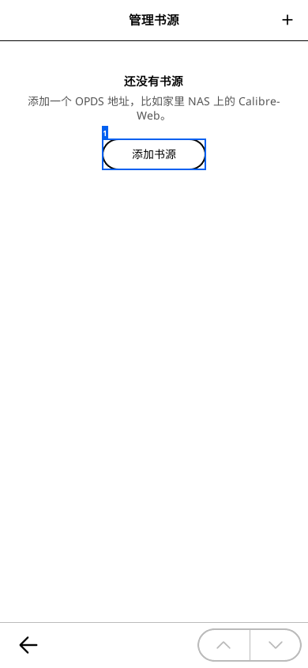。**1** "添加书源"是 40dp 高的 `PillButton`，可点区域就是它的框。这和宽度无关，归入下文"既有的触控目标不足"。

## 820 × 1180

| 页面 | 截图 | 标注 |
|---|---|---|
| 书架 | 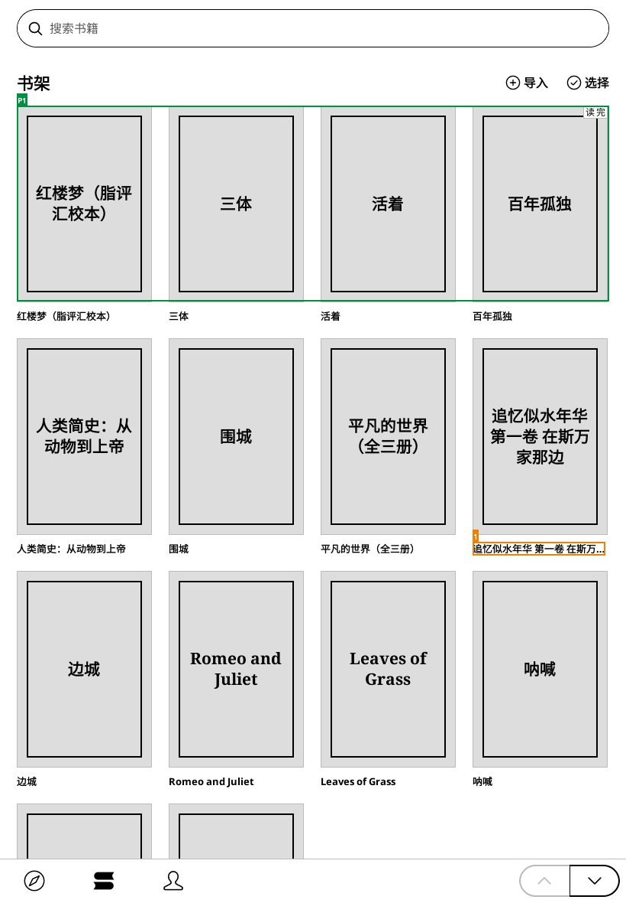 | **P1** 封面网格：4 列，封面 176×255dp，是参考的 1.43 倍。 **1** 书名单行截断（设计内）。 |
| 导入页 | 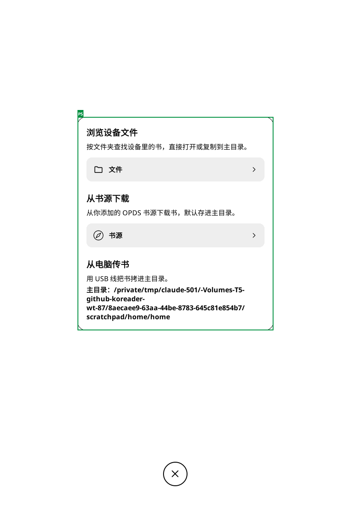 | **P5** 458dp 的卡片居中，两侧各留约 180dp 空白。这是设计行为（"最宽 458dp"）。 |
| 阅读页 | 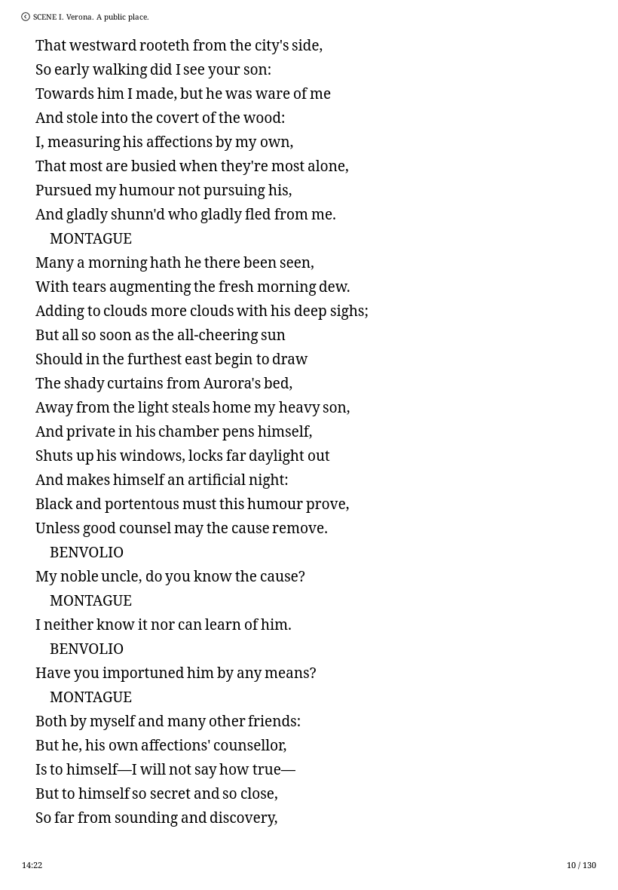 | 能放下。**P6** 行长：刚打开的书一行约 40 个汉字，见下文。 |
| 工具栏 | 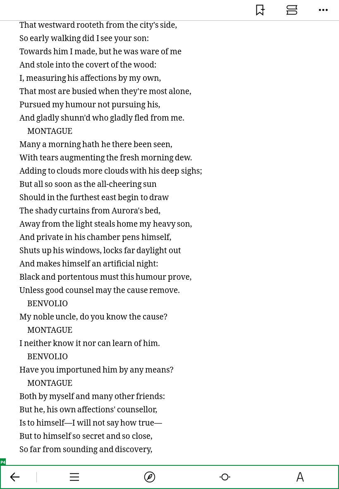 | **P4** 底栏五个图标均分 820dp，间距约 180dp，两两相距很远。 |
| 排版面板 | 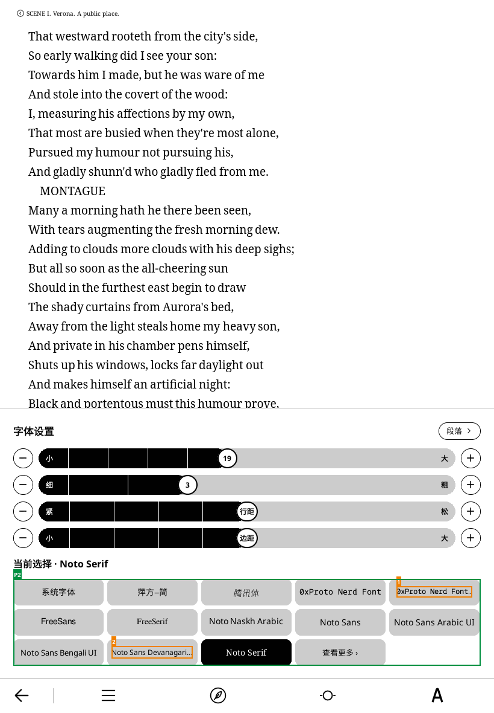 | **P2** 字体网格到了 5 列上限，卡片被拉到约 150dp（600 宽是 106dp）。 **1–2** 长字体名截断（设计内，600 宽也有）。 轨道档位间距 66–99dp，比参考宽，没有问题。 |
| 进度面板 | 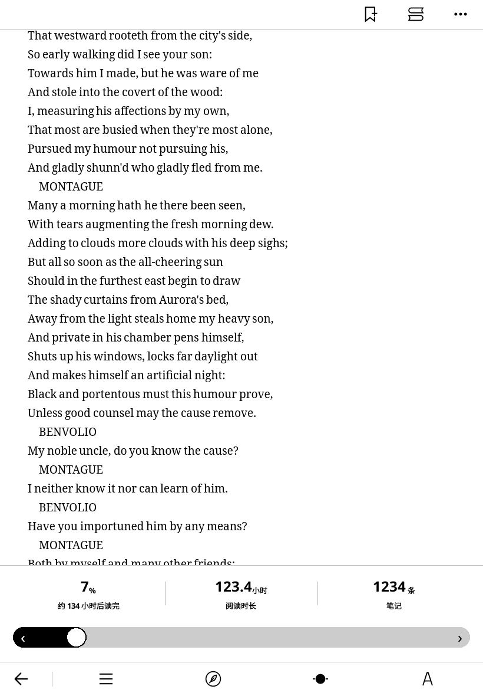 | 放得下。三列各约 258dp，进度轨道横跨 776dp。 |
| 目录页 | 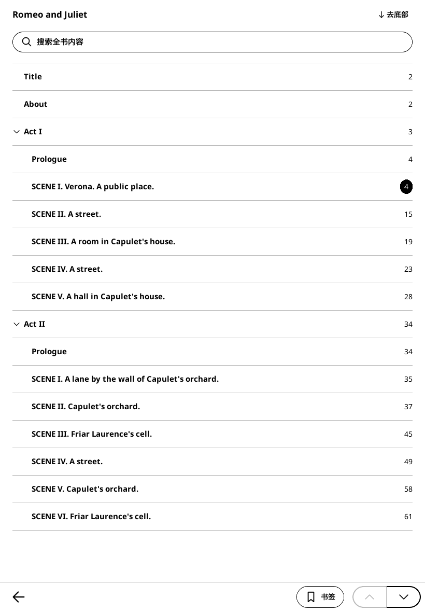 | 放得下。**P3** 行长 776dp，页码离章节名很远。 |
| 笔记页 | 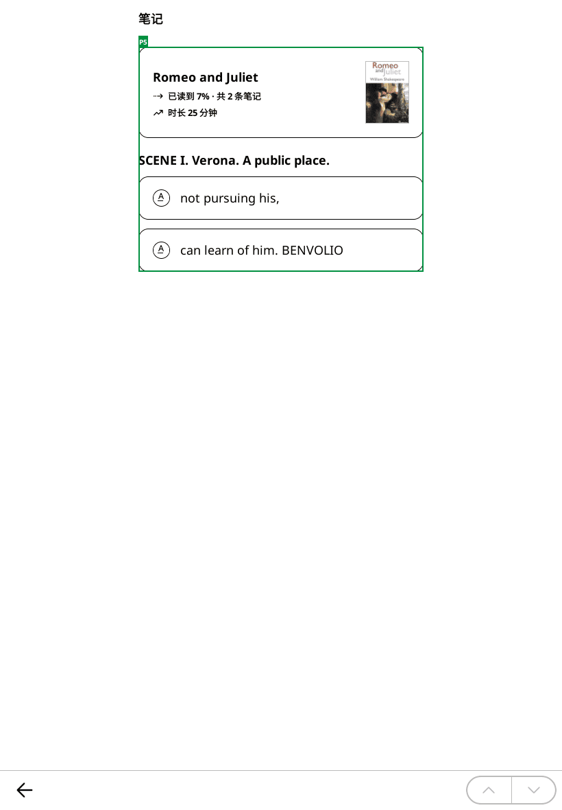 | **P5** 416dp 的卡片列居中，两侧各留约 200dp 空白。这是设计行为。 |
| 书源 | 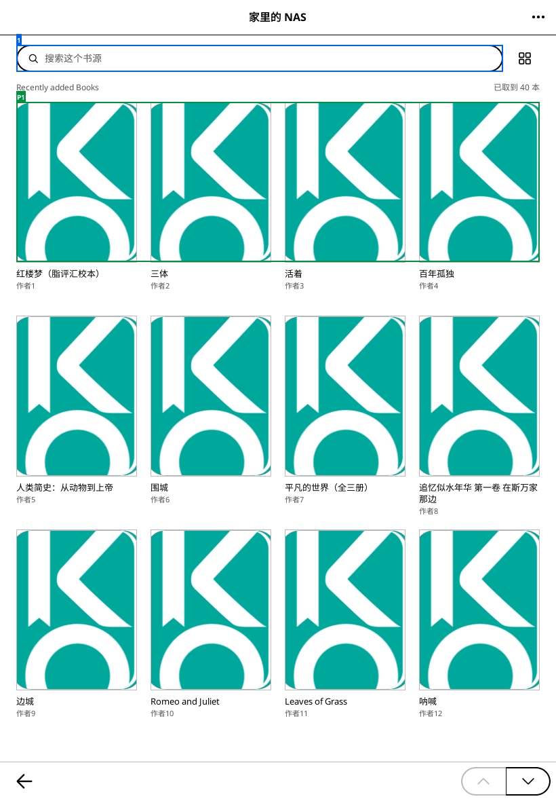 | **P1** 封面网格：4 列，封面 178×237dp。 **1** 搜索框 40dp（既有，同 390）。 |
| 我 | 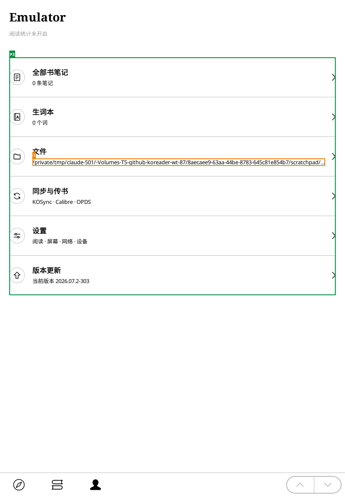 | **P3** 六行各 776dp 宽，右侧箭头离标题很远。 **1** 主目录路径截断（设计内）。 |

附：书源空状态 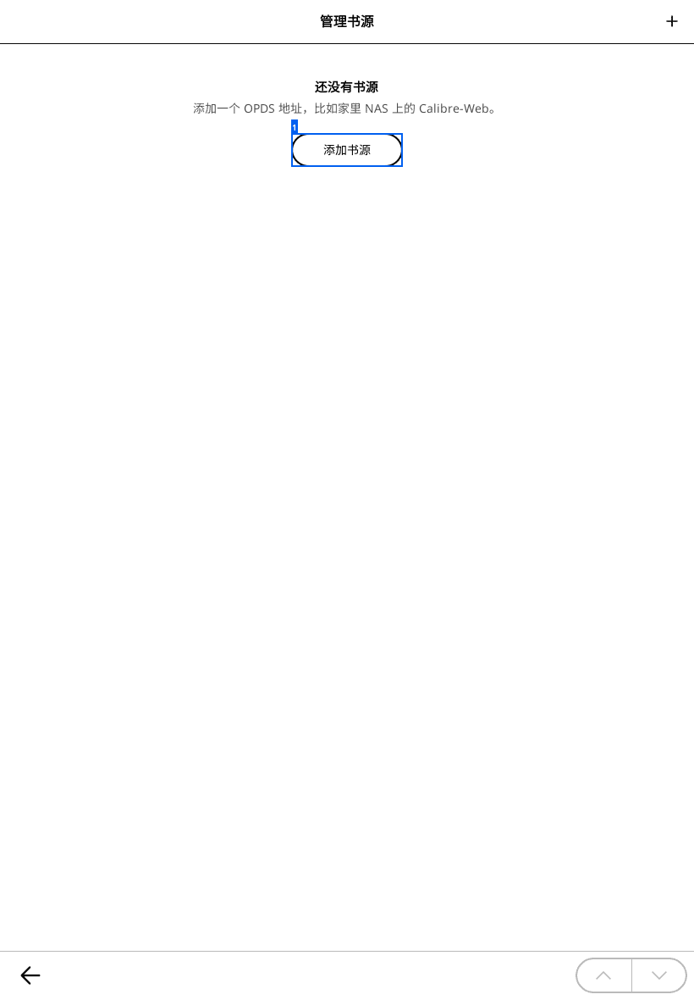。**1** "添加书源"按钮 40dp（既有）。

## 窄屏规则清单

只为放不下的组件补规则，不改组件尺寸。下面的宽度都是 dp，按 ADR-0008 的 1dp ≈ 1pt，可以直接对照 iPhone 的 point 宽度。

### R1 封面网格的列数（书架、书源）

- **现状**：两处都用 `ShelfWidgets.columnCount()` 定列数，依据是物理英寸 `getWidth() / getDPI()`：小于 3.9 英寸 3 列，小于 5.2 英寸 4 列，否则 5 列。然后用 `(内宽 − 列间距) / 列数` 反算封面宽。窄屏上无论 DPI 怎么定，都会落到 3 列，两处的封面都被压到 100dp 宽。
- **触发宽度**：3 列 123dp 封面需要 W ≥ 3×123 + 2×22 + 2×22 = **457dp**（书源的间距和边距是 20/24dp，算出来也约 457dp）。W < 457dp 时封面会被压缩。
- **规则**：W < 457dp 时，列数按宽度算，不再按英寸算，即 `max(2, floor((W − 2×边距 + 列间距) / (123 + 列间距)))`。封面保持 123×178dp（书源是 123×164），余量平均分到两侧边距。390 宽得到 2 列，边距约 61dp。
- **代价**：390 宽每页从 9 本（3×3）降到约 4 本（2×2 加 peek）。如果 B4 认为密度更重要，替代方案是保留 3 列，接受封面缩到 0.81 倍。但那等于在窄屏改组件尺寸，偏离 Proportion Rule，需要 owner 拍板。

### R2 排版面板轨道的档位间距（字号、字重、行距、边距）

- **现状**：`EinkControls.Track` 把档位均匀铺在药丸内部，档距 = (W − 226) / (档数 − 1)。行距和边距的旋钮写的是文字，比旋钮宽，所以是 W − 230。档位数分别是 10、7、9、9。实测 390 宽的档距是 18、27、20、20dp，小于 33dp 的旋钮：相邻两档挤在旋钮宽度之内，点轨道跳到最近一档已经点不准。
- **触发宽度**：按"档距小于旋钮直径 33dp"算，字号 W < **523dp**，行距和边距 W < **494dp**，字重 W < **424dp**。Leaf5 上字号档距约 42dp（DESIGN.md 写的是"约 41dp"），它和 iPhone 之间没有其他宽度等级。
- **规则**：低于触发宽度时，旋钮、刻线和 ± 圆钮的尺寸都不变；点轨道不再跳到最近一档，改为从旋钮出发向点按那一侧走一档，和 −/+ 的效果一样。连续调整靠 ± 或多点几下。每条轨道单独判断，所以 390 宽四条都按这条规则走。

### 自然收敛、不补规则的组件

issue 里预期要补规则的另外两项，实测放得下：

- **排版面板字体网格**：列数本来就按宽度算（`fontGridDimensions`，2 到 5 列，每列约 100dp），390 宽 3 列、卡片约 105dp，和墨水屏同尺寸。
- **进度面板三列**：390 宽每列 114dp，压测数值也放得下，宽度低于约 361dp 才会截断。
- **搜索框**：书架、目录页、书源的搜索框都随宽度伸缩，390 宽是 288–346dp，占位文字放得下。

## iPad 观察项（820 宽，交 B4 判断，本票不定规则）

820dp 比任何墨水屏竖屏的 600dp 都宽，问题方向反过来，是被拉稀、拉长：

- **P1 封面被放大**：书架 4 列 176dp、书源 4 列 178dp，是参考的 1.43 倍。如果列数改按宽度算（R1 只管 457dp 以下，不覆盖这里），820 宽是 5 列：封面保持 123dp 就多出边距，填满就是约 137dp，由 B4 选。列数还取决于 iOS 上 `getDPI()` 定成多少，见下一节。
- **P2 字体网格到上限后被拉宽**：5 列上限下卡片约 150dp。
- **P3 列表行过长**：我的六行、目录页的每一行都横跨 776dp，箭头和页码离文字很远。
- **P4 工具栏底栏的图标太散**：五个图标均分整宽，间距约 180dp。
- **P5 居中的卡片列两侧大面积留白**：导入页的 458dp 卡片、笔记页的 416dp 列都按设计居中。这是设计意图，列在这里只供 B4 确认在 iPad 上仍然可以接受。
- **P6 行长超过上限**：`ReaderTypesetPanel:marginsFor` 会把一行限制在 38 个汉字以内，但只在这本书已经在面板里选过边距（存了 `typeset_margin`）时才生效。刚打开的书用默认 28dp 边距，820 宽一行约 40 个汉字。

## DPI 依赖（交 B4 和阶段 A 的 DPI 决定）

`ShelfWidgets.columnCount()` 用 `getWidth() / getDPI()` 估算物理英寸。本次采集 `getDPI()` 是 160，所以 820 宽算作 5.1 英寸、4 列。如果 iOS 上报的是 iPad 11 英寸的真实密度（约 132 point/英寸），算出来是约 6.2 英寸、5 列。390 宽无论取哪种 DPI 都小于 3.9 英寸，落在 3 列。R1 让窄屏改为按 dp 宽度算列数，窄屏就不再受 DPI 影响。iPad 的列数要等 Q7 的倍率定下来再看。

## 既有的触控目标不足（与宽度无关）

下面两处在 600、390、820 宽都是 40dp，不是窄屏引入的。考虑到 Apple 的 44pt 建议，列给 B4：

- 书源的搜索框：`BookSourceView:buildSearch`，可以像清除按钮那样套用同文件的 `tallTarget`。
- 书源空状态的"添加书源"（`EinkControls.PillButton`，40dp）。其他用到 `PillButton` 的地方同样是 40dp。

## B4 的前置缺陷

无。十个页面加书源空状态在 390×844 和 820×1180 下都能正常打开和绘制，没有报错。

## 已排除的误报

自动初筛里核对后删掉的：

- 翻页胶囊（132×42dp）：每一半的可点区域至少 44dp 高（`PageCapsule.touch_h`），不是触控目标不足。
- 书架网格越出屏幕底部：这是 peek 行，即下一页第一行露在底栏下面，属于设计。peek 行里被截断的书名在屏幕外，也一并删掉。
- 封面文字框（`TextBoxWidget`）被当成可点目标：它挂的是选字手势，不是按钮。
